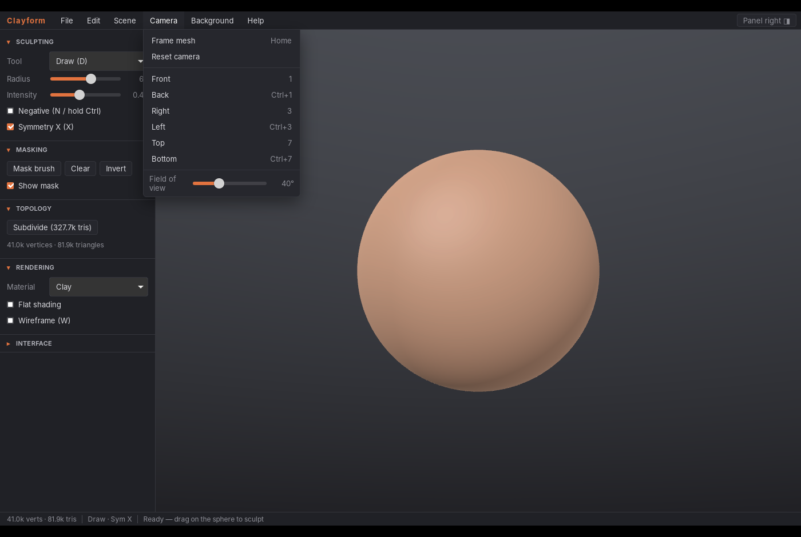

# Clayform

A digital sculpting app in Rust inspired by [SculptGL](https://stephaneginier.com/sculptgl/): a
[Tauri](https://tauri.app) desktop app with a [Leptos](https://leptos.dev) interface.

## Interface

Like SculptGL, the functions are grouped into dropdown areas:

- **Top-bar menus:** **File** (import, export OBJ/STL), **Edit** (undo, redo), **Scene** (new sphere, cube or plane,
  sphere detail), **Camera** (frame, reset, front/back/left/right/top/bottom views, field of view), **Background**
  (Dark gradient, Studio grey, Light, Black) and **Help** (controls).
- **Side-panel folders** (click a title to fold it): **Sculpting** (tool dropdown, radius, intensity, negative,
  symmetry), **Masking** (mask brush, clear, invert, show mask), **Topology** (multiresolution levels, subdivide, delete lower/higher, dynamic topology and detail, voxel remesh, mesh statistics),
  **Rendering** (material dropdown, flat shading, wireframe) and **Interface** (panel side).
- The side panel docks on the **left or right** of the viewport. Use the **Panel left / Panel right** button in the
  top bar, or **Interface › Panel side**. Your choice is remembered.

## Features

- **16 brushes**, each with its own radius and intensity. Hold Ctrl to invert a brush and Shift to smooth.
  - **Draw, Clay, Clay Buildup:** add material. Clay Buildup lays down fast, square-edged strips.
  - **Smooth, Flatten, Trim Dynamic, Scrape:** level the surface. Trim cuts peaks to crisp planes, and Scrape shaves
    high spots (Ctrl fills low ones).
  - **Inflate, Pinch, Crease, Dam Standard:** inflate, pinch, cut soft creases, or cut sharp, deep crease lines.
  - **Layer:** raises the surface to a fixed height per stroke, however many times you go over it.
  - **Grab, Snakehook, Nudge:** move the surface. Snakehook pulls out horns and tentacles (best with dynamic
    topology), and Nudge smears it along the stroke.
  - **Mask:** protects areas from the other brushes.
- **Symmetry:** mirror across X, Y and/or Z, plus **radial** copies (2–32 around X, Y or Z), about the world
  origin or the model's own centre. Ghost cursors show where every copy lands.
- **Dynamic topology** (like SculptGL's dynamic mode or ZBrush's Sculptris Pro): long edges under the brush are
  split and short ones collapsed, so detail appears only where you sculpt. **Size by Brush** keeps triangles at a
  share of the brush radius (35 % at Detail 0 down to 3 % at 100 %). **Size by Constant** keeps them a fixed size on
  the model (20 to 500 across it), whatever the brush or zoom. With **Smooth brush reduces detail** on, smoothing
  also coarsens the mesh, as in Sculptris Pro. Turn dynamic topology on and off with `T`.
- **Multiresolution levels** (like ZBrush subdivision levels): **Subdivide** adds a smoother level above the
  highest one. Step down to rework big shapes and back up without losing fine detail. Detail is stored in each
  vertex's local frame, so it follows big-shape changes. **Delete lower** and **Delete higher** merge levels.
  Dynamic topology needs a single level, as in ZBrush.
- **Voxel remesh** (like ZBrush's DynaMesh): rebuilds the sculpt as an even, closed mesh from a voxel grid. It
  merges overlapping parts into one surface, closes holes (open meshes become a thin shell) and evens out stretched
  or dynamic-topology areas. **Resolution** is the number of voxels across the longest side (16–512). **Smooth**
  relaxes the new mesh. **Project** snaps it back onto the original shape so it stays crisp. Press `R` to remesh.
- **Background jobs:** in the desktop app, voxel remesh and subdivide run on a separate thread. A progress card with
  **Cancel** appears, and you can keep rotating the view. The finished mesh is then prepared a slice at a time between
  frames, and undo no longer copies the whole sculpt for level changes, subdivisions or remeshes, so the window
  doesn't freeze at the end.
- **Masking**, **Loop subdivision** (up to 6M triangles) and **undo/redo** for every stroke, level change and
  mesh change.
- **Import/export** OBJ and STL (Ctrl+I / Ctrl+E). Imported meshes are rescaled for sculpting and exported at their original scale.
- **Projects (.clayform):** save and open your work with every level, the mask, the camera and all brush and view
  settings. The title bar shows ` •` when there are unsaved changes, and opening a project can be undone.
- **Viewport:** ambient occlusion and cavity shading (each with a strength slider), custom matcaps loaded from
  PNG or JPEG images (remembered between sessions), and WebGL 2 through wgpu, 4× MSAA, six procedural matcaps, wireframe and flat shading.

## Controls

| Input | Action |
|---|---|
| Left drag on mesh | Sculpt |
| Shift + drag | Smooth |
| Ctrl + drag | Invert brush |
| Left drag on background, Alt + left, right drag | Rotate |
| Middle drag, Shift + right drag | Pan |
| Wheel | Zoom |
| `D C B S F Y Q I` | Draw, Clay, Clay Buildup, Smooth, Flatten, Trim Dynamic, Scrape, Inflate |
| `P E V L G K U M` | Pinch, Crease, Dam Standard, Layer, Grab, Snakehook, Nudge, Mask |
| `[` `]` | Brush radius |
| `X` / `W` / `N` | Toggle mirror X / wireframe / negative |
| Ctrl+Z, Ctrl+Shift+Z or Ctrl+Y | Undo / redo |
| Ctrl+O / Ctrl+S / Ctrl+Shift+S | Open / save / save project as |
| Ctrl+D | Subdivide (add a level) |
| Page Up / Page Down | Higher / lower level |
| `T` | Dynamic topology on/off |
| `R` | Voxel remesh |
| Ctrl+I / Ctrl+E | Import / export mesh |
| Home | Frame mesh |
| `1` `3` `7` (Ctrl for the opposite side) | Front, right, top views |

## Project layout

| Folder | What it is |
|---|---|
| `core/` | **clayform-core**: the engine. Mesh, brushes, undo, BVH picking, camera, editor input logic, OBJ/STL. No interface code. |
| `app/` | **clayform-app**: the Leptos interface and wgpu (WebGL 2) viewport, compiled to WebAssembly together with the engine, so strokes never wait on the desktop backend. |
| `src-tauri/` | **clayform**: the Tauri desktop shell. It opens the window, provides native Open/Save dialogs, and runs remesh and subdivide jobs on a background thread (meshes travel in a compact binary format, `core/src/wire.rs`). |

## Run

    rustup target add wasm32-unknown-unknown
    cargo install trunk
    npx @tauri-apps/cli@2 dev        # live-reloading window
    npx @tauri-apps/cli@2 build      # target/release/clayform.exe and an installer

The interface also runs in a browser with WebGL 2 (`cd app && trunk serve`, then open http://localhost:1420). There,
Import and Export use the browser's file picker and downloads.

Tests: `cargo test` (engine: symmetry, project files, meshes, subdivision, dynamic topology, multiresolution, voxel remesh, picking, brushes, strokes, undo, symmetry, OBJ/STL).

## Windows build

- **From Linux without GitHub:** `./build-windows.sh` produces `dist/Clayform-setup.exe` (installer) and
  `dist/Clayform-portable.zip` (Clayform.exe + WebView2Loader.dll). If rustup can't download the WebAssembly and
  Windows targets, the script builds Rust's standard library from source instead.
- **GitHub Actions:** every push to `main` is built on Windows. Publishing a release with a `v*` tag attaches
  `Clayform.exe` and `Clayform-setup.exe` to it.

Clayform uses Microsoft Edge WebView2, which Windows 10 and 11 include. The installer adds it if a PC lacks it.

## Roadmap ideas

ZRemesher-style retopology, multiple objects (SubTools), alpha/stamp textures, layers, vertex painting, and a lasso mask.

## Automated testing hook

If the `CLAYFORM_TEST_FILE` environment variable is set, the desktop app's Open project, Save project and Load matcap
use that file instead of showing a dialog. It exists for scripted UI tests on machines with nobody to click the
dialogs, and normal use never sets it.
