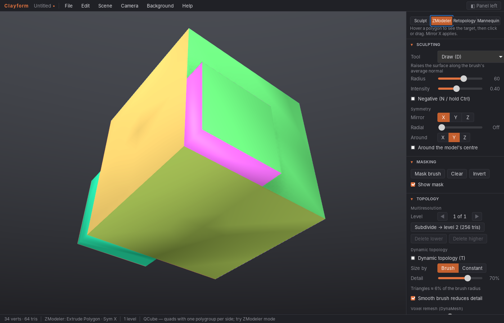
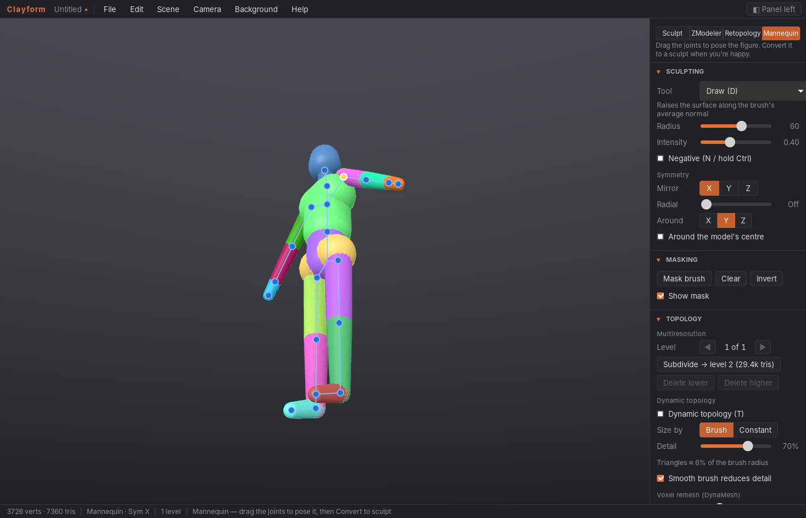
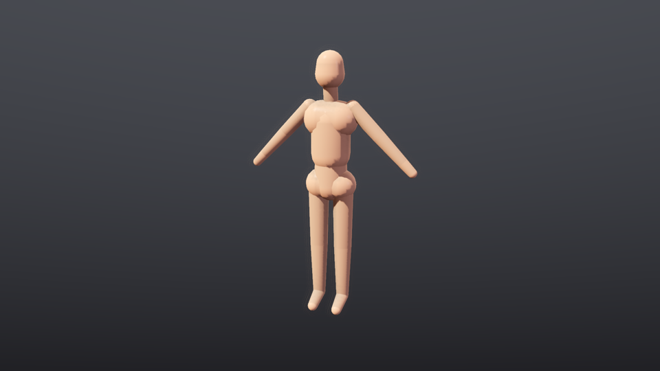

# Clayform

A digital sculpting app in Rust inspired by [SculptGL](https://stephaneginier.com/sculptgl/): a
[Tauri](https://tauri.app) desktop app with a [Leptos](https://leptos.dev) interface.

| ZModeler with polygroup colours | Mannequin |
|---|---|
|  |  |

A rendered image (Lit skin, shadows from the key light): 

## Interface

Like SculptGL, the functions are grouped into dropdown areas:

- **Modes** (buttons at the top of the panel, or `Tab`): **Sculpt** (brushes), **Gizmo** (move, turn, scale and
  deform the active SubTool), **ZModeler** (polygon modelling), **Retopo** (draw new topology over the sculpt) and
  **Mannequin** (pose a figure).
- **Top-bar menus:** **File** (projects, import OBJ/STL, export OBJ/STL/PLY/glTF/FBX), **Render** (render image,
  render turntable), **Edit** (undo, redo), **Scene** (new sphere, cube or plane,
  quad QCube/QSphere/QCylinder/QPlane, mannequin, sphere detail), **Camera** (frame, reset, front/back/left/right/top/bottom views, field of view), **Background**
  (Dark gradient, Studio grey, Light, Black) and **Help** (controls).
- **Side-panel folders** (click a title to fold it): **SubTools** (the objects in the scene, Live Boolean),
  **History**, **Sculpting** (tool dropdown, radius, intensity, negative,
  symmetry), **Masking** (mask brush, clear, invert, show mask), **Topology** (multiresolution levels, subdivide, delete lower/higher, dynamic topology and detail, voxel remesh, mesh statistics),
  **Transform** (gizmo and deformers), **Array**, **ZModeler**, **Polygroups**, **Retopology**, **Mannequin**, **Snapshot 3D**, **Reference images**, **Lights**,
  **Render**, **Export** (formats and 3D printing), **Viewport display** (material dropdown, AO, cavity, flat
  shading, wireframe, polygroup colours) and **Interface** (panel side).
- The side panel docks on the **left or right** of the viewport. Use the **Panel left / Panel right** button in the
  top bar, or **Interface › Panel side**. Your choice is remembered.

## Features

- **SubTools:** a scene holds any number of separate objects. The **SubTools** folder lists them: click one to
  sculpt it (the others are drawn greyed), click the dot to show or hide it, double-click the name to rename it,
  and use ▲▼ to reorder. **Append** adds a primitive, a QMesh, a mannequin or an imported OBJ/STL beside the scene;
  **Duplicate**, **Delete**, **Merge visible** (joins every visible SubTool into one) and **Split by polygroups**
  (one SubTool per polygroup) manage them. Alt+click a SubTool in the viewport to select it. Every SubTool keeps its
  own levels, mask and undo history. Export (and 3D-print export) writes every visible SubTool by default
  (**Export › All visible SubTools**).
- **Gizmo mode (Transform):** a move/rotate/scale gizmo on the active SubTool. Drag the coloured arrows to move along
  an axis, the centre dot to move freely, the rings to rotate, the end dots to scale one axis, and the dashed outer
  ring to scale evenly. If part of the SubTool is masked, only the unmasked part moves (with soft mask edges).
  Hold Ctrl as you start a drag to snap moves to round steps, turns to 15° and scales to 0.1. Each drag is one
  undo step.
- **Gizmo deformers** (Transform folder): **Bend, Twist, Taper, Flatten, Inflate** along X, Y or Z. Pick one and
  drag left or right in the viewport to set the amount; masking limits the effect.
- **Live Boolean:** each SubTool has an operation badge: **Add**, **Subtract** or **Intersect** (click it to
  change). Tick **Show the boolean result** and the viewport shows the combined result, top to bottom, updating
  when you let go of a stroke. **Make boolean mesh** builds the result as a new, closed SubTool at the Topology
  remesh resolution (the parts are hidden, not deleted).
- **Arrays** (Array folder): repeat the active SubTool along a **line** (offset, turn and scale per copy), around a
  **circle** (radius, sweep, axis) or in a **grid** (counts and gap), up to 64 copies. Copies are drawn live while
  you sculpt the original, take part in Live Boolean and export, and **Convert to mesh** makes them real geometry.
- **41 brushes**, grouped in the Tool list, each with its own radius and intensity. Hold Ctrl to invert a brush and Shift to smooth.
  - **Draw, Clay, Clay Buildup:** add material. Clay Buildup lays down fast, square-edged strips.
  - **Smooth, Flatten, Trim Dynamic, Scrape:** level the surface. Trim cuts peaks to crisp planes, and Scrape shaves
    high spots (Ctrl fills low ones).
  - **Inflate, Pinch, Crease, Dam Standard:** inflate, pinch, cut soft creases, or cut sharp, deep crease lines.
  - **Layer:** raises the surface to a fixed height per stroke, however many times you go over it.
  - **Grab, Snakehook, Nudge:** move the surface. Snakehook pulls out horns and tentacles (best with dynamic
    topology), and Nudge smears it along the stroke.
  - **Mask:** protects areas from the other brushes.
  - **Clay Tubes, Blob, Magnify, Planar, Trim Front, Rake, Slash:** square-ended clay strokes along the stroke
    direction, bulbous build-up, spreading the surface (Ctrl shrinks it), flattening to the stroke's starting height,
    cutting flat facing the camera, combing parallel grooves, and very sharp cuts.
  - **Polish, hPolish, mPolish, Smooth Valleys, Smooth Peaks, Smooth Stronger:** clean, polished planes; hard planes;
    flattening that keeps edges crisp; smoothing only the low or only the high spots; heavy multi-pass smoothing.
  - **Move, Move Topological (Grab), Move Elastic, Move Infinite Depth:** drag everything in the brush sphere, only
    the connected surface, with a long rubbery falloff, or straight through the whole model.
  - **Anchors:** drag to **move, rotate, scale, inflate, twist or bend** the region under the brush.
  - **Curve Snakehook:** draw a path, release, and a horn is pulled along it, tapering to the tip.
  - **Curve Tube, Curve Strap:** draw a curve over the model and release to add a round tube or a flat strap along
    it (brush size sets the thickness; intensity how far a tube sits out of the surface; Ctrl tapers a tube). The new
    geometry joins the sculpt as one undo step, or becomes its own SubTool if the sculpt has several levels.
  - **Chisel:** press and drag out a 3D shape (rivet, button, ring, star, cross, gem, screw head, ridge) onto the
    surface; Ctrl presses it in. The shapes are height fields, so they can't undercut like ZBrush's vector chisels.
  - **Cloth Pull, Cloth Twist, Cloth Inflate:** move the surface like fabric (edge lengths are kept, so it folds
    instead of stretching).
  - **Polygroup Paint:** paints a new polygroup.
- **Stroke & alpha folder:**
  - **Stroke types:** **Freehand** (evenly spaced dabs, with a Spacing slider), **Dots** (a dab per pointer event),
    **Drag Rect** (press where the stamp goes, drag out its size and turn, release to keep it) and **Spray** (scattered
    dabs varying in size, strength and turn).
  - **Lazy mouse:** the brush trails the pointer on a string (a line shows it), for clean, smooth lines.
  - **Pen pressure:** with a drawing tablet or pen, pressure can change the size and/or the strength.
  - **Backface masking** (on by default): brushes leave alone surfaces facing away, so thin parts like ears and
    fingers don't get sculpted through.
  - **Falloff curve editor:** drag the points (left is the brush centre, right its edge), click the line to add a
    point and double-click to remove one, or pick a shape (Smooth, Linear, Sharp, Dome, Flat, Hard, Ring). It
    applies to every brush, including Move and the cloth brushes.
  - **Alphas:** ten built-in grayscale stamps (pores, scales, weave, rings, square, noise, cracks, bumps, stitches,
    hexagons) or **Load image…** for your own PNG/JPEG. White raises (or carves, with Negative), black leaves the
    surface alone. **Turn** rotates the alpha; **Turn with the stroke** makes it follow the stroke direction.
- **Layers** (Layers folder): **New layer** starts recording (REC): strokes go into the layer. Hide it with the
  dot, fade it with its slider (negative inverts, above 100% exaggerates), rename it (double-click), bake it into
  the sculpt (⤵) or delete it. Each layer belongs to one level; layers turn dynamic topology off. Saved in projects.
- **Surface detail folder:**
  - **Morph target:** **Store** the shape, keep sculpting, and paint parts back with the **Morph** brush;
    **Switch** swaps the sculpt with the stored shape.
  - **Surface Noise:** Smooth, Ridged, Cells or Crackle noise over the whole model, with size, height, detail and
    seed. **Preview** shows it live while you move the sliders; **Apply** keeps it (one undo step). Masked areas
    stay smooth.
  - **Project All:** pulls the active SubTool onto the other visible SubTools' surfaces along its normals, within
    a distance, e.g. to move an old sculpt's detail onto a new, cleaner mesh.
  - **Reproject higher levels:** when a remesh, ZModeler edit or other topology change removes a sculpt's levels,
    **Rebuild N levels** subdivides the new base again and projects the old highest level's detail onto it.
- **Brush presets:** save the current brush (tool, size, strength, stroke, falloff and alpha) under a name, load it
  with a click, and **export** it as a `.claybrush` file to share or **import** one. Six starter presets show the
  features (skin pores, reptile scales, fabric weave, clean lines, rivets, a stitched seam).
- **ZModeler** (polygon modelling, like ZBrush's ZModeler): hover a polygon to see the target highlighted, then
  click or drag. Actions: **Extrude**, **Inset**, **Bevel** (drag to set the amount, one undo step), **Insert edge
  loop**, **Delete**, **Bridge** (click two polygons or holes, with the same number of edges, to join them with a
  tube), **Polygroup** and **PolyGroupIt**. Targets: **Polygon**, **Polygroup** or **Polyloop** (the quad strip
  across the picked edge). Mirror X applies. Start from **QCube, QSphere, QCylinder or QPlane** with 1–12 divisions.
- **Polygroups and quads:** every face belongs to a polygroup (shown in colour with `Shift+G`), and quads stay quads
  (two partner triangles) through ZModeler, subdivision, projects and OBJ import/export, which also writes each
  polygroup as an OBJ `g` group. The wireframe hides quad diagonals. **Group by normals**, **Group masked**,
  **Clear**, the **Polygroup Paint** brush and **PolyGroupIt** set them.
- **Retopology:** click on the sculpt to place points; every four make a quad (click the first point again or press
  `Enter` to close a triangle or n-gon). Click existing points to share them, drag points to slide them over the
  surface, `Ctrl`+click to delete, `Ctrl+Z` to step back. **Relax** evens the spacing while staying on the surface,
  **Mirror X** copies to the other side, and **Apply** replaces the sculpt, optionally with 1–5 subdivision levels
  each projected onto the old sculpt so its detail carries over.
- **Mannequins:** a posable figure of capsules (each bone its own polygroup). Drag a joint to aim its bone; presets
  T-pose, A-pose, Walk, Sit, Arms up and Run; a **Build** slider. **Convert to sculpt** voxel-merges it into one surface.
- **Snapshot 3D:** turns an image's silhouette (dark pixels, or opaque ones in a transparent PNG; **Invert** for
  light shapes) into a solid: **Inflate** (pillowy) or **Extrude** (flat), with depth and resolution. **New** starts a
  sculpt from it, **Add** places it on the surface facing you, and **Subtract** cuts it straight through the model,
  both merged with a voxel remesh.
- **Reference images** (like Spotlight): pin PNG/JPEG images over the viewport, drag to place, drag the corner to
  size, set opacity, hide, or lock them so you sculpt through. They're saved in the project.
- **Symmetry:** mirror across X, Y and/or Z, plus **radial** copies (2–32 around X, Y or Z), about the world
  origin or the model's own centre. Ghost cursors show where every copy lands.
- **Dynamic topology** (like SculptGL's dynamic mode or ZBrush's Sculptris Pro): long edges under the brush are
  split and short ones collapsed, so detail appears only where you sculpt. **Size by Brush** keeps triangles at a
  share of the brush radius (35 % at Detail 0 down to 3 % at 100 %). **Size by Constant** keeps them a fixed size on
  the model (20 to 500 across it), whatever the brush or zoom. With **Smooth brush reduces detail** on, smoothing
  also coarsens the mesh, as in Sculptris Pro. Turn dynamic topology on and off with `T`.
- **Multiresolution levels** (like ZBrush subdivision levels): **Subdivide** adds a smoother level above the
  highest one. Step down to rework big shapes and back up without losing fine detail. Detail is stored in each
  vertex's local frame, so it follows big-shape changes. **Delete lower** and **Delete higher** merge levels.
  Dynamic topology needs a single level, as in ZBrush.
- **Voxel remesh** (like ZBrush's DynaMesh): rebuilds the sculpt as an even, closed mesh from a voxel grid. It
  merges overlapping parts into one surface, closes holes (open meshes become a thin shell) and evens out stretched
  or dynamic-topology areas. **Resolution** is the number of voxels across the longest side (16–512). **Smooth**
  relaxes the new mesh. **Project** snaps it back onto the original shape so it stays crisp. Press `R` to remesh.
- **Background jobs:** in the desktop app, voxel remesh and subdivide run on a separate thread. A progress card with
  **Cancel** appears, and you can keep rotating the view. The finished mesh is then prepared a slice at a time between
  frames, and undo no longer copies the whole sculpt for level changes, subdivisions or remeshes, so the window
  doesn't freeze at the end.
- **Masking**, **Loop subdivision** (up to 6M triangles) and **undo/redo** for every stroke, level change and
  mesh change.
- **Import** OBJ and STL (Ctrl+I) and **export** OBJ, STL, PLY, glTF binary (.glb) and FBX (binary 7.4) from
  **File** or the **Export** folder. OBJ, PLY and FBX keep quads; OBJ writes polygroups as groups; PLY and glTF
  carry polygroup colours. Imported meshes are rescaled for sculpting and exported at their original scale.
- **3D printing:** set the longest side in mm, cm or inches, check the mesh (holes, edges shared by three or more
  faces, inside-out shells, piece count), fix it with **Make watertight** (a voxel remesh), and export an STL in
  millimetres, Z up, centred on the plate and sitting at Z = 0.
- **Lights and Lit materials:** six **Lit** materials (clay, skin, gold, plastic, ceramic, bronze) shaded by a
  four-light rig (key, fill, rim, bounce), each with direction, colour and strength. The lights can turn with the
  camera or stay put, and the key light casts soft **shadows**. Matcap materials work as before.
- **Render image** (`F12`): renders off screen at the viewport size, ×2, HD, 1440p, 4K or square sizes, with an
  optional **transparent background** and **depth of field** (focused on the model at the centre of the view),
  and saves a PNG.
- **Turntable:** the camera circles the model (24–360 frames at 24, 30 or 60 fps) and saves an **MP4** video
  (WebM where MP4 isn't available), an animated **GIF** (up to 640 pixels), or the frames as **PNGs in a ZIP** for
  video editors.
- **Projects (.clayform):** save and open your work with every level, the mask, the camera and all brush and view
  settings, and every SubTool with its operation and array. The title bar shows ` •` when there are unsaved
  changes. Projects from earlier versions open as a single SubTool.
  **File › Open recent** lists the last ten projects.
- **Autosave and crash recovery** (desktop app): every few minutes (Interface › Autosave, 1–30 minutes or off),
  once you pause, unsaved work is copied to a recovery file. If Clayform closes without saving, the next start
  offers **Recover** or **Discard**. Saving the project removes the copy.
- **History:** the History folder lists every undoable step by name (Draw, Clay, Voxel remesh, Extrude…); click
  one to jump back or forward to it.
- **Keyboard shortcuts** are all rebindable (Help › All keyboard shortcuts…, or Interface): click a command, press
  the new keys; a key already in use moves over. Changes are remembered.
- **Speed on dense meshes:** brushes refit only the part of the picking hierarchy they touched and re-upload only
  the blocks of vertices that changed. On a 1.3M-triangle sculpt a brush movement went from about 28 ms to 2.5 ms,
  and the data sent to the GPU per movement shrank about 23×.
- **Viewport:** ambient occlusion and cavity shading (each with a strength slider), custom matcaps loaded from
  PNG or JPEG images (remembered between sessions), and WebGL 2 through wgpu, 4× MSAA, six procedural matcaps, wireframe and flat shading.

## Controls

These are the defaults; every key can be changed in **Help › All keyboard shortcuts…**.

| Input | Action |
|---|---|
| Left drag on mesh | Sculpt |
| Shift + drag | Smooth |
| Ctrl + drag | Invert brush |
| Left drag on background, Alt + left, right drag | Rotate |
| Middle drag, Shift + right drag | Pan |
| Wheel | Zoom |
| `D C B S F Y Q I` | Draw, Clay, Clay Buildup, Smooth, Flatten, Trim Dynamic, Scrape, Inflate |
| `P E V L G K U M` | Pinch, Crease, Dam Standard, Layer, Move Topological (Grab), Snakehook, Nudge, Mask |
| `J H O` | Move, Clay Tubes, Polish (every brush is in the Tool list) |
| `Tab` / Shift+Tab | Next / previous mode (Sculpt, Gizmo, ZModeler, Retopo, Mannequin) |
| Alt + click on an object | Select that SubTool |
| Shift+G | Polygroup colours |
| `Enter` / Esc | Retopology: close the face / drop the picked points |
| `[` `]` | Brush radius |
| `X` / `W` / `N` | Toggle mirror X / wireframe / negative |
| Ctrl+Z, Ctrl+Shift+Z or Ctrl+Y | Undo / redo |
| Ctrl+O / Ctrl+S / Ctrl+Shift+S | Open / save / save project as |
| Ctrl+D | Subdivide (add a level) |
| Page Up / Page Down | Higher / lower level |
| `T` | Dynamic topology on/off |
| `R` | Voxel remesh |
| Ctrl+I / Ctrl+E | Import / export mesh |
| Home | Frame the scene |
| F12 | Render image |
| `1` `3` `7` (Ctrl for the opposite side) | Front, right, top views |

## Project layout

| Folder | What it is |
|---|---|
| `core/` | **clayform-core**: the engine. Mesh, brushes, undo, BVH picking, camera, editor input logic, OBJ/STL. No interface code. |
| `app/` | **clayform-app**: the Leptos interface and wgpu (WebGL 2) viewport, compiled to WebAssembly together with the engine, so strokes never wait on the desktop backend. |
| `src-tauri/` | **clayform**: the Tauri desktop shell. It opens the window, provides native Open/Save dialogs, and runs remesh and subdivide jobs on a background thread (meshes travel in a compact binary format, `core/src/wire.rs`). |

## Run

    rustup target add wasm32-unknown-unknown
    cargo install trunk
    npx @tauri-apps/cli@2 dev        # live-reloading window
    npx @tauri-apps/cli@2 build      # target/release/clayform.exe and an installer

The interface also runs in a browser with WebGL 2 (`cd app && trunk serve`, then open http://localhost:1420). There,
Import and Export use the browser's file picker and downloads.

Tests: `cargo test` (engine: sculpt layers, morph target, surface noise, Project All, reprojecting levels, falloff curves, alphas, chisel shapes, lazy mouse, Drag Rect, Spray and Dots strokes, pen pressure, backface masking, curve tubes and straps, SubTools (append, select, split, merge), arrays, boolean parts, gizmo moves and deformers, undo history names and jumps, partial BVH refits, exporters (FBX structure, GLB, PLY, print placement and watertight checks), symmetry, project files, meshes, subdivision, dynamic topology, multiresolution, voxel remesh and subtract, picking, brushes (including dragging, curve and cloth brushes), strokes, undo, ZModeler actions and primitives, polygroups and quads, retopology, mannequins, Snapshot 3D, OBJ/STL).

## Windows build

- **From Linux without GitHub:** `./build-windows.sh` produces `dist/Clayform-setup.exe` (installer) and
  `dist/Clayform-portable.zip` (Clayform.exe + WebView2Loader.dll). If rustup can't download the WebAssembly and
  Windows targets, the script builds Rust's standard library from source instead.
- **GitHub Actions:** every push to `main` is built on Windows. Publishing a release with a `v*` tag attaches
  `Clayform.exe` and `Clayform-setup.exe` to it.

Clayform uses Microsoft Edge WebView2, which Windows 10 and 11 include. The installer adds it if a PC lacks it.

## Roadmap ideas

Multithreaded brushes (needs WebAssembly threads in the window), automatic (ZRemesher-style) retopology, vertex painting, and a lasso mask.

## Automated testing hook

If `CLAYFORM_TEST_SAVE_DIR` is set, every Save dialog for exports, renders and turntables is skipped and the file
is written into that folder. If the `CLAYFORM_TEST_FILE` environment variable is set, the desktop app's Open project, Save project, Load matcap
and image pickers (Snapshot 3D, reference images) use that file instead of showing a dialog. It exists for scripted UI tests on machines with nobody to click the
dialogs, and normal use never sets it.
